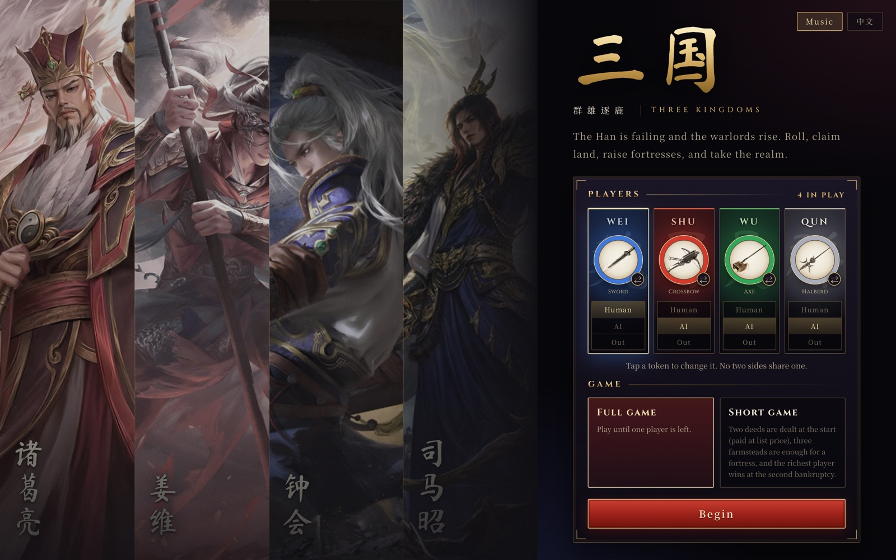
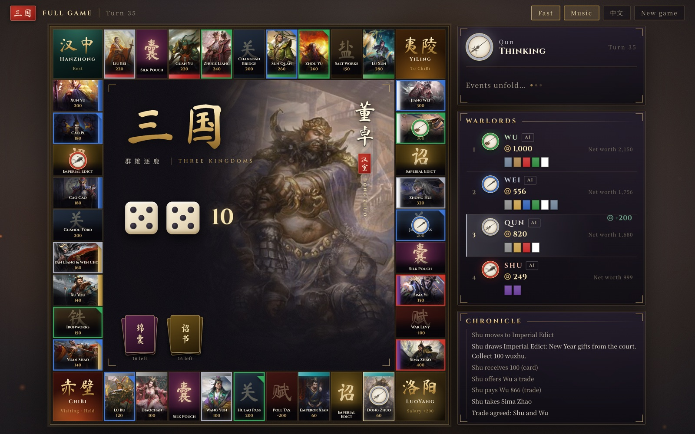

<p align="center">
  
</p>

<h1 align="center">三国 · Three Kingdoms</h1>

<p align="center">
  <b>A property-trading board game set at the fall of the Han, with computer opponents that learn to play it.</b>
</p>

<p align="center">
  English · <a href="README.zh-CN.md">中文</a>
</p>

<p align="center">
  <a href="#at-a-glance">At a glance</a> ·
  <a href="#play-it">Play it</a> ·
  <a href="#the-computer-opponents">The computer opponents</a> ·
  <a href="#where-things-are">Where things are</a> ·
  <a href="#documentation">Documentation</a>
</p>

---

Wei, Shu, Wu and Qun roll for the order of play, travel a board of warlords, passes and works, buy and build on what they land on, trade, and try to be the last one standing. The game runs in the browser or as a macOS app, in Chinese or English, with any mix of people and computer players.

## At a glance

| | |
| --- | --- |
| **Players** | 2 to 4: Wei, Shu, Wu and Qun, each a person or the computer, each with a weapon token of their choice |
| **Board** | 40 squares: 22 streets in 8 groups, 4 passes, 2 works, and two decks of 16 cards |
| **Games** | The full game, played to the last player standing, or the short game (60 to 90 minutes), ranked by net worth at the second bankruptcy |
| **Runs** | In the browser, or as the macOS app *The Romance of Three Kingdoms: Tycoon* |
| **Languages** | Chinese and English, switched at any time |
| **Computer players** | Today's rule-based player, dozens of named styles, styles found by search, and a two-player agent trained by reinforcement learning |
| **Code** | A rules engine in TypeScript with no dependencies; a React client; training in Python and PyTorch |
| **Tests** | 280 TypeScript tests and 53 Python tests |

<p align="center">
  
  <br>
  <sub>Turn 35 of a four-player game the computer plays against itself: owned streets carry their owner's colour, and the chronicle records a trade just agreed.</sub>
</p>

## Play it

Node.js 22.18 or later is needed: the engine and its tests are TypeScript files that Node runs directly.

```bash
npm install
npm run dev          # then open http://localhost:5173
```

| Command | What it does |
| --- | --- |
| `npm run dev` | Serves the client with hot reload on port 5173. |
| `npm run app:install` | Builds the macOS app and installs it in `/Applications`, where Launchpad finds it (`npm run app` builds it without installing). |
| `npm test` | Runs the TypeScript tests. |
| `npm run typecheck` | Type-checks the engine, the scripts, the tests and the client. |
| `npm run build` | Builds the client into `dist/` for a web server. |

## The computer opponents

The goal is computer players that are strong, varied and pleasant to play against: they read the table, trade well, form and break alliances, and play differently with two, three or four at the table. The work goes in stages, each closed by measured bars written before it is run.

| Stage | What it does | Where it stands |
| --- | --- | --- |
| M0 | A study of 706,000 simulated games: what the board rewards | Done |
| M1 | Valuation: what a property is really worth, not its list price | Done |
| M2 | Schools of play: dozens of named styles, from the pass baron to the dealer | Built; 33 of 36 behaviour bars met, the rest being retuned |
| M3 | Style search, and lines of succession (a new version must beat the best so far) | Run; four players short of one style |
| M3b | Table politics: deal values, alliances by offers, buying from a failing player | Four of eight bars met; two being fixed, two waiting on runs |
| M4 | The environment that lets a network play thousands of moves a second | Done |
| M5 | A network that imitates the rule-based player, as the starting point | Bar 2 met; two bars open |
| **M6** | **Reinforcement learning: two players (G1), then four, then three** | **G1 passed on 20 November 2026** |
| **M9** | **Trading: the learner makes its own offers** | **Moved forward to come before four players; foundation built** |
| M7 | Every table size in the full game; one shared agent against specialists | Code for its first steps written |
| M8 | League training, and learning when to change plan | To do |
| M10 | The opponents in the client | Started: choosing an opponent for each computer seat |

**Where the two-player agent stands (G1).** Trained from the imitation network over 50 million decisions, three times from different random seeds:

| Against | Wins | For comparison |
| --- | --- | --- |
| The built-in rule-based player, 1,000 games | **89.5% to 90.2%** across the three seeds | An even share is 50% |
| The refuser, a test player that turns down every trade, 5,000 games in the same seat | **31 points higher** than the refuser scores there | The refuser itself beats the rule-based player 58% to 50% |
| The strongest style the search found (seed 1) | **77.6%** | That style wins 87% against the rule-based player |
| Its own starting point, in the promotion match (seed 1) | **An edge of 77 points** | It now holds the two-player line |

The three seeds agree within a point on every measure. What it cannot do yet: make its own offers (a rule-based school proposes for it until M9's two-player steps run), and play three or four at the table.

## Where things are

The default branch, `main`, holds only the first commit. The work is on branches, each built on the one before:

| Branch | What it adds |
| --- | --- |
| [`ai/m10-opponents`](https://github.com/Otieur/raymonds-game/tree/ai/m10-opponents) | **The latest.** Choosing an opponent for each computer seat (M10, in progress) |
| [`ai/m9-trading`](https://github.com/Otieur/raymonds-game/tree/ai/m9-trading) | Trading: sales for cash, the offer suite, the trade report, G2 and G3 set up to trade |
| [`ai/m7-branch-and-members`](https://github.com/Otieur/raymonds-game/tree/ai/m7-branch-and-members) | G1's results, branching training runs, paired intervals |
| [`ai/paired-intervals`](https://github.com/Otieur/raymonds-game/tree/ai/paired-intervals), [`ai/decisions-2026-11-19`](https://github.com/Otieur/raymonds-game/tree/ai/decisions-2026-11-19), [`ai/m3b-to-m6`](https://github.com/Otieur/raymonds-game/tree/ai/m3b-to-m6) | The overnight runs of 18 and 19 November and the decisions that followed |
| [`game/opening-roll-and-client`](https://github.com/Otieur/raymonds-game/tree/game/opening-roll-and-client) | The opening roll for the order of play, and the web client |
| [`three-kingdoms`](https://github.com/Otieur/raymonds-game/tree/three-kingdoms) | The Three Kingdoms board, the short game and two rule fixes ([pull request #1](https://github.com/Otieur/raymonds-game/pull/1)) |

```text
src/              The rules engine (start at src/index.ts), the agents and the simulator
  engine/         One file per part of the rules
  boards/         The Three Kingdoms board: names, colours, art
  env/            What a network sees and may do, and the network in TypeScript
  sim/            Valuation, schools of play, league, politics, offer suite, opponents
web/              The browser client: the store that drives a game, screens, styling
train/            Training in Python: imitation, reinforcement learning, configurations
scripts/          Studies, tables, evaluation, promotion matches, reports, queues
test/             TypeScript tests (train/tests/ holds the Python ones)
assets/           Portraits, tokens, music, the app icon, and the lines of succession
docs/             Rules, engine, client, statistics, the AI design, and the stage plans
```

## Documentation

| Document | Read it for |
| --- | --- |
| [docs/rules.md](docs/rules.md) | The game as implemented: the board, every rule, the short game |
| [docs/engine.md](docs/engine.md) | How the engine works and how to call it: state, actions, events, determinism |
| [docs/frontend.md](docs/frontend.md) | How the client is built: the store, pacing, saving, languages, styling |
| [docs/statistics.md](docs/statistics.md) | What hundreds of thousands of simulated games show about the board |
| [docs/ai.md](docs/ai.md) | The design of the computer opponents and the evidence behind it |
| [docs/plan/README.md](docs/plan/README.md) | The plan stage by stage, with every stage's bars and results |
| [docs/plan/log.md](docs/plan/log.md) | The record of every run: what was measured, decided and changed |

<details>
<summary><b>Using the engine from code</b></summary>

The engine is a set of pure functions over a plain-JSON state. A game is a loop: ask who must act, ask what they may do, apply one action.

```ts
import { createEngine, threeKingdoms } from './src/index.ts';

const engine = createEngine(threeKingdoms);
let state = engine.newGame({ players: ['wei', 'shu', 'wu', 'qun'], seed: 7 });

while (state.winner === null) {
  const [actor] = engine.awaiting(state);
  const legal = engine.legalActions(state, actor);
  const result = engine.apply(state, pick(legal)); // pick: your own choice among the legal actions
  if (!result.ok) throw new Error(result.error.message);
  state = result.state; // result.events says what happened
}
```

A bid lists the range of amounts and a trade proposal the possible partners, rather than ready-made actions; [docs/engine.md](docs/engine.md) covers both.

</details>

## Artwork and music

The street portraits and the token drawings are third-party illustrations from the card game Sanguosha (三国杀), and the background music is a third-party recording. They are here for private development only and are not licensed for redistribution: replace them or obtain a licence before the repository or any build of the game is made public. The app icon was drawn for this project.

## Licence

No licence has been chosen. The repository is private.
