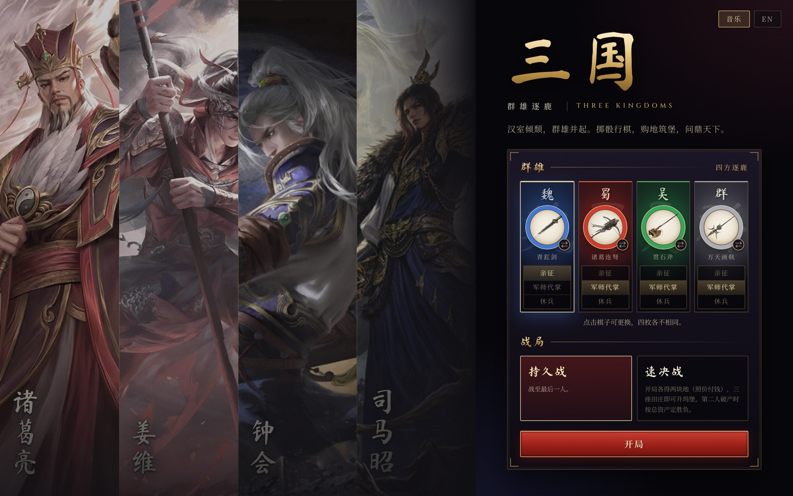
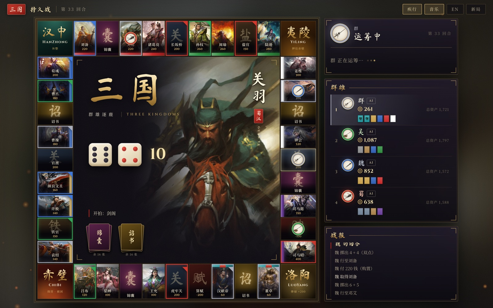

<p align="center">
  
</p>

<h1 align="center">三国 · Three Kingdoms</h1>

<p align="center">
  <b>A property-trading board game set at the fall of the Han, with computer opponents that learn to play it.</b><br>
  <b>汉末三国背景的买地经营棋盘游戏，电脑对手会自己学着下。</b>
</p>

<p align="center">
  <a href="#english"><b>English</b></a> · <a href="#中文"><b>中文</b></a>
</p>

---

## English

<p>
  <a href="#at-a-glance">At a glance</a> ·
  <a href="#play-it">Play it</a> ·
  <a href="#the-computer-opponents">The computer opponents</a> ·
  <a href="#where-things-are">Where things are</a> ·
  <a href="#documentation">Documentation</a>
</p>

Wei, Shu, Wu and Qun roll for the order of play, travel a board of warlords, passes and works, buy and build on what they land on, trade, and try to be the last one standing. The game runs in the browser or as a macOS app, in Chinese or English, with any mix of people and computer players.

### At a glance

| | |
| --- | --- |
| **Players** | 2 to 4: Wei, Shu, Wu and Qun, each a person or the computer, each with a weapon token of their choice |
| **Board** | 40 squares: 22 streets in 8 groups, 4 passes, 2 works, and two decks of 16 cards |
| **Games** | The full game, played to the last player standing, or the short game (60 to 90 minutes), ranked by net worth at the second bankruptcy |
| **Runs** | In the browser, or as the macOS app *The Romance of Three Kingdoms: Tycoon* |
| **Languages** | Chinese and English, switched at any time |
| **Computer players** | Chosen for each computer seat on the opening screen: today's rule-based player, named characters such as the pass baron and the dealer, the strongest style the search found, and, once shipped, the two-player agent trained by reinforcement learning |
| **Code** | A rules engine in TypeScript with no dependencies; a React client; training in Python and PyTorch |
| **Tests** | 286 TypeScript tests and 53 Python tests |

<p align="center">
  
  <br>
  <sub>Turn 35 of a four-player game the computer plays against itself: owned streets carry their owner's colour, and the chronicle records a trade just agreed.</sub>
</p>

### Play it

Node.js 22.18 or later is needed: the engine and its tests are TypeScript files that Node runs directly.

```bash
npm install
npm run dev          # then open http://localhost:5173
```

| Command | What it does |
| --- | --- |
| `npm run dev` | Serves the client with hot reload on port 5173. |
| `npm run app:install` | Builds the macOS app and installs it in `/Applications`, where Launchpad finds it (`npm run app` builds it without installing). |
| `npm test` | Runs the TypeScript tests. |
| `npm run typecheck` | Type-checks the engine, the scripts, the tests and the client. |
| `npm run build` | Builds the client into `dist/` for a web server. |

### The computer opponents

The goal is computer players that are strong, varied and pleasant to play against: they read the table, trade well, form and break alliances, and play differently with two, three or four at the table. The work goes in stages, each closed by measured bars written before it is run.

| Stage | What it does | Where it stands |
| --- | --- | --- |
| M0 | A study of 706,000 simulated games: what the board rewards | Done |
| M1 | Valuation: what a property is really worth, not its list price | Done |
| M2 | Schools of play: dozens of named styles, from the pass baron to the dealer | Built; 33 of 36 behaviour bars met, the rest being retuned |
| M3 | Style search, and lines of succession (a new version must beat the best so far) | Run; four players short of one style |
| M3b | Table politics: deal values, alliances by offers, buying from a failing player | Four of eight bars met; two being fixed, two waiting on runs |
| M4 | The environment that lets a network play thousands of moves a second | Done |
| M5 | A network that imitates the rule-based player, as the starting point | Bar 2 met; two bars open |
| **M6** | **Reinforcement learning: two players (G1), then four, then three** | **G1 passed on 20 November 2026** |
| **M9** | **Trading: the learner makes its own offers** | **Moved forward to come before four players; foundation built** |
| M7 | Every table size in the full game; one shared agent against specialists | Code for its first steps written |
| M8 | League training, and learning when to change plan | To do |
| M10 | The opponents in the client | First version in the game: an opponent for each computer seat, learned ones run in the background, at most five offers from a computer seat a turn, and a chance for everyone, you included, to buy from a player who cannot pay; the two-player agent ships when the data disk is back |

**Where the two-player agent stands (G1).** Trained from the imitation network over 50 million decisions, three times from different random seeds:

| Against | Wins | For comparison |
| --- | --- | --- |
| The built-in rule-based player, 1,000 games | **89.5% to 90.2%** across the three seeds | An even share is 50% |
| The refuser, a test player that turns down every trade, 5,000 games in the same seat | **31 points higher** than the refuser scores there | The refuser itself beats the rule-based player 58% to 50% |
| The strongest style the search found (seed 1) | **77.6%** | That style wins 87% against the rule-based player |
| Its own starting point, in the promotion match (seed 1) | **An edge of 77 points** | It now holds the two-player line |

The three seeds agree within a point on every measure. What it cannot do yet: make its own offers (a rule-based school proposes for it until M9's two-player steps run), and play three or four at the table.

### Where things are

`main` always holds the latest version, which is now `ai/m10-opponents`. The branches below record how it got there, each built on the one below it:

| Branch | What it adds |
| --- | --- |
| [`ai/m10-opponents`](https://github.com/Otieur/raymonds-game/tree/ai/m10-opponents) | **The latest.** Choosing an opponent for each computer seat (M10, in progress) |
| [`ai/m9-trading`](https://github.com/Otieur/raymonds-game/tree/ai/m9-trading) | Trading: sales for cash, the offer suite, the trade report, G2 and G3 set up to trade |
| [`ai/m7-branch-and-members`](https://github.com/Otieur/raymonds-game/tree/ai/m7-branch-and-members) | G1's results, branching training runs, paired intervals |
| [`ai/paired-intervals`](https://github.com/Otieur/raymonds-game/tree/ai/paired-intervals), [`ai/decisions-2026-11-19`](https://github.com/Otieur/raymonds-game/tree/ai/decisions-2026-11-19), [`ai/m3b-to-m6`](https://github.com/Otieur/raymonds-game/tree/ai/m3b-to-m6) | The overnight runs of 18 and 19 November and the decisions that followed |
| [`game/opening-roll-and-client`](https://github.com/Otieur/raymonds-game/tree/game/opening-roll-and-client) | The opening roll for the order of play, and the web client |
| [`three-kingdoms`](https://github.com/Otieur/raymonds-game/tree/three-kingdoms) | The Three Kingdoms board, the short game and two rule fixes ([pull request #1](https://github.com/Otieur/raymonds-game/pull/1)) |

```text
src/              The rules engine (start at src/index.ts), the agents and the simulator
  engine/         One file per part of the rules
  boards/         The Three Kingdoms board: names, colours, art
  env/            What a network sees and may do, and the network in TypeScript
  sim/            Valuation, schools of play, league, politics, offer suite, opponents
web/              The browser client: the store that drives a game, screens, styling
train/            Training in Python: imitation, reinforcement learning, configurations
scripts/          Studies, tables, evaluation, promotion matches, reports, queues
test/             TypeScript tests (train/tests/ holds the Python ones)
assets/           Portraits, tokens, music, the app icon, and the lines of succession
docs/             Rules, engine, client, statistics, the AI design, and the stage plans
```

### Documentation

| Document | Read it for |
| --- | --- |
| [docs/rules.md](docs/rules.md) | The game as implemented: the board, every rule, the short game |
| [docs/engine.md](docs/engine.md) | How the engine works and how to call it: state, actions, events, determinism |
| [docs/frontend.md](docs/frontend.md) | How the client is built: the store, pacing, saving, languages, styling |
| [docs/statistics.md](docs/statistics.md) | What hundreds of thousands of simulated games show about the board |
| [docs/ai.md](docs/ai.md) | The design of the computer opponents and the evidence behind it |
| [docs/plan/README.md](docs/plan/README.md) | The plan stage by stage, with every stage's bars and results |
| [docs/plan/log.md](docs/plan/log.md) | The record of every run: what was measured, decided and changed |

<details>
<summary><b>Using the engine from code</b></summary>

The engine is a set of pure functions over a plain-JSON state. A game is a loop: ask who must act, ask what they may do, apply one action.

```ts
import { createEngine, threeKingdoms } from './src/index.ts';

const engine = createEngine(threeKingdoms);
let state = engine.newGame({ players: ['wei', 'shu', 'wu', 'qun'], seed: 7 });

while (state.winner === null) {
  const [actor] = engine.awaiting(state);
  const legal = engine.legalActions(state, actor);
  const result = engine.apply(state, pick(legal)); // pick: your own choice among the legal actions
  if (!result.ok) throw new Error(result.error.message);
  state = result.state; // result.events says what happened
}
```

A bid lists the range of amounts and a trade proposal the possible partners, rather than ready-made actions; [docs/engine.md](docs/engine.md) covers both.

</details>

### Artwork, music and licence

The street portraits and the token drawings are third-party illustrations from the card game Sanguosha (三国杀), and the background music is a third-party recording. None of them is licensed for redistribution, and they are to be replaced or licensed. The app icon was drawn for this project. No licence has been chosen for the code.

---

## 中文

<p>
  <a href="#一眼看懂">一眼看懂</a> ·
  <a href="#怎么运行">怎么运行</a> ·
  <a href="#电脑对手">电脑对手</a> ·
  <a href="#东西在哪">东西在哪</a> ·
  <a href="#文档">文档</a>
</p>

<p align="center">
  
</p>

魏、蜀、吴、群四方掷骰定先后，在满是名将、关隘和官营产业的棋盘上行棋，买下落脚的地、盖田庄筑坞堡、互相交易，最后撑到不破产的一方获胜。游戏可以在浏览器里玩，也可以作为 macOS 应用打开；中英文随时切换，真人和电脑可以任意搭配。

### 一眼看懂

| | |
| --- | --- |
| **人数** | 2 到 4 方：魏、蜀、吴、群，每方可以是真人或电脑，棋子从四件兵器里自选 |
| **棋盘** | 40 格：8 组共 22 块地、4 个关隘、2 处官营产业（铁官、盐官），锦囊和诏书各 16 张 |
| **战局** | 持久战：打到只剩一方；速决战：60 到 90 分钟，第二个人破产时按总资产排名 |
| **运行** | 浏览器，或 macOS 应用 *The Romance of Three Kingdoms: Tycoon* |
| **语言** | 中文、英文，随时切换 |
| **电脑对手** | 开局界面给每个电脑座位单独挑：游戏原有的规则打法、关隘大亨和掮客这样有名有姓的流派人物、程序搜索出的最强打法，以及（装进游戏后）用强化学习练出来的二人局 AI |
| **代码** | TypeScript 写的规则引擎（不依赖任何库）、React 前端、Python 和 PyTorch 训练 |
| **测试** | TypeScript 测试 286 项，Python 测试 53 项 |

<p align="center">
  
  <br>
  <sub>四方都由电脑下的一局，到了第 33 回合：有主的地标着主人的颜色，群已经筑起两座坞堡。</sub>
</p>

### 怎么运行

需要 Node.js 22.18 或更新版本：引擎和测试都是 TypeScript 文件，Node 直接就能跑。

```bash
npm install
npm run dev          # 然后打开 http://localhost:5173
```

| 命令 | 作用 |
| --- | --- |
| `npm run dev` | 启动开发服务器（端口 5173），改代码页面自动刷新 |
| `npm run app:install` | 打包 macOS 应用并装进“应用程序”，启动台里就能找到（`npm run app` 只打包不安装） |
| `npm test` | 跑 TypeScript 测试 |
| `npm run typecheck` | 检查引擎、脚本、测试和前端的类型 |
| `npm run build` | 把前端打包到 `dist/`，放到网页服务器上用 |

### 电脑对手

目标是让电脑对手又强、又有个性、跟它下着舒服：会看局势、会做交易、懂得结盟和翻脸，二人局、三人局、四人局各有各的下法。工作分阶段进行，每个阶段开跑前都先写好及格线，量出来达标才算完成。

| 阶段 | 做什么 | 进度 |
| --- | --- | --- |
| M0 | 模拟 70.6 万局，摸清这个棋盘的规律 | 完成 |
| M1 | 估价：算出一块地真正值多少，而不是只看标价 | 完成 |
| M2 | 流派：几十种有名有姓的打法，从关隘大亨到掮客 | 已建好；36 条行为检查过了 33 条，其余在调 |
| M3 | 打法搜索，以及“冠军线”：新版本必须打赢历史最强才能接班 | 已跑；四人局还差一种打法 |
| M3b | 桌面政治：交易估价、用交易示好结盟、收快破产者的地 | 8 条门槛过了 4 条；2 条在修，2 条等跑 |
| M4 | 训练环境：让神经网络一秒下几千步 | 完成 |
| M5 | 先让神经网络模仿规则打法，作为强化学习的起点 | 第 2 条门槛已过；还有 2 条没过 |
| **M6** | **强化学习：先二人局（G1），再四人局，再三人局** | **G1 于 2026 年 11 月 20 日通过** |
| **M9** | **交易：AI 自己提交易** | **已提前到四人局之前；地基已写好** |
| M7 | 所有人数的完整对局；比较一个通用 AI 和各人数的专门 AI | 前几步的代码已写好 |
| M8 | 联赛训练，学会什么时候换打法 | 未开始 |
| M10 | 把对手放进游戏里 | 第一版已进游戏：每个电脑座位都能挑对手，神经网络对手在后台运行；每个电脑座位一回合最多提五次交易；有人还不起债时，包括你在内的其他人都有机会先出价买它的地；二人局 AI 等数据硬盘接回后装进去 |

**二人局 AI（G1）的成绩。** 从模仿网络出发练了 5000 万步，换三组随机数各练了一遍：

| 对手 | 成绩 | 对比 |
| --- | --- | --- |
| 游戏原有的规则打法，1000 局 | 三遍分别赢 **89.5% 到 90.2%** | 平均胜率是 50% |
| “拒绝交易者”（专门拒绝一切交易的测试对手），同一位置 5000 局 | 比拒绝交易者在同一位置的胜率**高 31 个百分点** | 拒绝交易者自己对规则打法是 58% 对 50% |
| 程序搜索出的二人局最强打法（第 1 遍） | **77.6%** | 那个打法对规则打法能赢 87% |
| 它的出发点，在晋级赛里（第 1 遍） | **领先 77 个百分点** | 现在是二人局的冠军 |

三遍练出来的结果，每一项都相差不到一个百分点。它暂时还做不到的：自己提交易（在 M9 的二人局交易训练跑完之前，由规则流派替它提），以及三人、四人同桌。

### 东西在哪

`main` 永远是最新版本，现在和 `ai/m10-opponents` 一样。下面这些分支记录了一路的进展，每个都在下面那个的基础上往上长：

| 分支 | 新增了什么 |
| --- | --- |
| [`ai/m10-opponents`](https://github.com/Otieur/raymonds-game/tree/ai/m10-opponents) | **最新。**给每个电脑座位挑对手（M10，进行中） |
| [`ai/m9-trading`](https://github.com/Otieur/raymonds-game/tree/ai/m9-trading) | 交易：卖地换钱、交易题库、交易报告，G2、G3 改成会自己提交易 |
| [`ai/m7-branch-and-members`](https://github.com/Otieur/raymonds-game/tree/ai/m7-branch-and-members) | G1 的成绩、训练分支、按局配对的比较方法 |
| [`ai/paired-intervals`](https://github.com/Otieur/raymonds-game/tree/ai/paired-intervals)、[`ai/decisions-2026-11-19`](https://github.com/Otieur/raymonds-game/tree/ai/decisions-2026-11-19)、[`ai/m3b-to-m6`](https://github.com/Otieur/raymonds-game/tree/ai/m3b-to-m6) | 11 月 18、19 日两晚的运行，以及之后的决定 |
| [`game/opening-roll-and-client`](https://github.com/Otieur/raymonds-game/tree/game/opening-roll-and-client) | 开局掷骰定先后，以及网页前端 |
| [`three-kingdoms`](https://github.com/Otieur/raymonds-game/tree/three-kingdoms) | 三国棋盘、速决战和两处规则修正（[PR #1](https://github.com/Otieur/raymonds-game/pull/1)） |

```text
src/              规则引擎（从 src/index.ts 看起）、电脑对手和模拟器
  engine/         每条规则一个文件
  boards/         三国棋盘：地名、颜色、美术
  env/            神经网络看到什么、能做什么，以及 TypeScript 版的网络
  sim/            估价、流派、联赛、桌面政治、交易题库、对手列表
web/              网页前端：驱动对局的 store、各个界面、样式
train/            Python 训练：模仿学习、强化学习、训练配置
scripts/          模拟研究、对局表、评估、晋级赛、报告、排队脚本
test/             TypeScript 测试（Python 测试在 train/tests/）
assets/           人物画、棋子、音乐、应用图标，以及冠军线记录
docs/             规则、引擎、前端、统计、AI 设计和分阶段计划
```

### 文档

文档统一用英文写，和代码保持一致。

| 文档 | 看什么 |
| --- | --- |
| [docs/rules.md](docs/rules.md) | 游戏规则：棋盘、每一条规则、速决战 |
| [docs/engine.md](docs/engine.md) | 引擎怎么工作、怎么调用：状态、动作、事件、可复现 |
| [docs/frontend.md](docs/frontend.md) | 前端怎么搭的：store、节奏、存档、语言、样式 |
| [docs/statistics.md](docs/statistics.md) | 几十万局模拟对这个棋盘说明了什么 |
| [docs/ai.md](docs/ai.md) | 电脑对手的整体设计，以及背后的数据 |
| [docs/plan/README.md](docs/plan/README.md) | 分阶段计划，每个阶段的及格线和结果 |
| [docs/plan/log.md](docs/plan/log.md) | 每一次运行的记录：量了什么、定了什么、改了什么 |

<details>
<summary><b>在代码里调用引擎</b></summary>

引擎是一组纯函数，状态是普通的 JSON。一局游戏就是一个循环：问谁该行动、问他能做什么、执行一个动作。

```ts
import { createEngine, threeKingdoms } from './src/index.ts';

const engine = createEngine(threeKingdoms);
let state = engine.newGame({ players: ['wei', 'shu', 'wu', 'qun'], seed: 7 });

while (state.winner === null) {
  const [actor] = engine.awaiting(state);
  const legal = engine.legalActions(state, actor);
  const result = engine.apply(state, pick(legal)); // pick：在合法动作里自己挑一个
  if (!result.ok) throw new Error(result.error.message);
  state = result.state; // result.events 记录发生了什么
}
```

竞拍给出的是出价范围，提交易给出的是可选的交易对象，而不是现成的动作；[docs/engine.md](docs/engine.md) 里有说明。

</details>

### 美术、音乐和许可

地块上的人物画和棋子图是卡牌游戏《三国杀》的第三方美术，背景音乐也是第三方录音。它们都没有转发授权，之后要么替换，要么取得授权。应用图标是为这个项目画的。代码还没有选定许可。

<p align="center"><a href="#english">↑ English</a> · <a href="#中文">↑ 中文</a></p>
